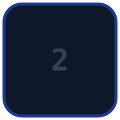
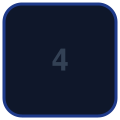
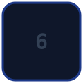
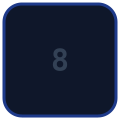
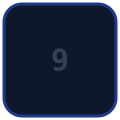

<div align="center">

# 🎮 Community Tic-Tac-Toe

**One board, open to everyone. Click a square and make the next move.**

<a href="https://github.com/mchittineni/community-tic-tac-toe/actions/workflows/play.yaml"></a>
<a href="https://github.com/mchittineni/community-tic-tac-toe/actions/workflows/tests.yaml"></a>
[](LICENSE)
[](https://github.com/mchittineni/community-tic-tac-toe/pulls)

[](https://buymeacoffee.com/mchittineni)
[](https://github.com/sponsors/mchittineni)

</div>

<!-- TICTACTOE:START -->
<div align="center">

<p>
  
  
  
</p>

Everyone is welcome to play! **Click an empty square** to place the next mark. It's **❌**'s turn.

<table>
  <tr>
    <td><a href="https://github.com/mchittineni/community-tic-tac-toe/issues/new?title=ttt%7Cmove%7Cx%7C1&body=Just+press+%27Submit+new+issue%27+without+editing+the+title.+The+board+updates+in+about+30+seconds."></a></td>
    <td><a href="https://github.com/mchittineni/community-tic-tac-toe/issues/new?title=ttt%7Cmove%7Cx%7C2&body=Just+press+%27Submit+new+issue%27+without+editing+the+title.+The+board+updates+in+about+30+seconds."></a></td>
    <td><a href="https://github.com/mchittineni/community-tic-tac-toe/issues/new?title=ttt%7Cmove%7Cx%7C3&body=Just+press+%27Submit+new+issue%27+without+editing+the+title.+The+board+updates+in+about+30+seconds."></a></td>
  </tr>
  <tr>
    <td><a href="https://github.com/mchittineni/community-tic-tac-toe/issues/new?title=ttt%7Cmove%7Cx%7C4&body=Just+press+%27Submit+new+issue%27+without+editing+the+title.+The+board+updates+in+about+30+seconds."></a></td>
    <td><a href="https://github.com/mchittineni/community-tic-tac-toe/issues/new?title=ttt%7Cmove%7Cx%7C5&body=Just+press+%27Submit+new+issue%27+without+editing+the+title.+The+board+updates+in+about+30+seconds."></a></td>
    <td><a href="https://github.com/mchittineni/community-tic-tac-toe/issues/new?title=ttt%7Cmove%7Cx%7C6&body=Just+press+%27Submit+new+issue%27+without+editing+the+title.+The+board+updates+in+about+30+seconds."></a></td>
  </tr>
  <tr>
    <td><a href="https://github.com/mchittineni/community-tic-tac-toe/issues/new?title=ttt%7Cmove%7Cx%7C7&body=Just+press+%27Submit+new+issue%27+without+editing+the+title.+The+board+updates+in+about+30+seconds."></a></td>
    <td><a href="https://github.com/mchittineni/community-tic-tac-toe/issues/new?title=ttt%7Cmove%7Cx%7C8&body=Just+press+%27Submit+new+issue%27+without+editing+the+title.+The+board+updates+in+about+30+seconds."></a></td>
    <td><a href="https://github.com/mchittineni/community-tic-tac-toe/issues/new?title=ttt%7Cmove%7Cx%7C9&body=Just+press+%27Submit+new+issue%27+without+editing+the+title.+The+board+updates+in+about+30+seconds."></a></td>
  </tr>
</table>

Tired of waiting? [Let the bot 🤖 play ❌](https://github.com/mchittineni/community-tic-tac-toe/issues/new?title=ttt%7Cmove%7Cx%7Cbot&body=Just+press+%27Submit+new+issue%27+without+editing+the+title.+The+board+updates+in+about+30+seconds.)

⭕ won the last game. Winning move by TicTacToeBot 🤖 🏆

❌ wins: **0** · ⭕ wins: **1** · Draws: **1**

</div>

**⏰ Most recent moves**

| Team | Square | Played by |
| :--: | :----: | --------- |
| ⭕ | 6 | TicTacToeBot 🤖 (asked by [@mchittineni](https://github.com/mchittineni)) |
| ❌ | 4 | [@mchittineni](https://github.com/mchittineni) |
| ⭕ | 3 | TicTacToeBot 🤖 (asked by [@mchittineni](https://github.com/mchittineni)) |
| ❌ | 1 | [@mchittineni](https://github.com/mchittineni) |
| ⭕ | 2 | TicTacToeBot 🤖 (asked by [@mchittineni](https://github.com/mchittineni)) |

**🏆 Leaderboard: most game-winning moves**

| Player | Wins |
| ------ | :--: |
| TicTacToeBot 🤖 | 1 |

<!-- TICTACTOE:END -->

## How to play

1. Click any **empty square** on the board above.
2. GitHub opens a new issue with your move already filled in. Press **Submit new issue** without changing the title.
3. About 30 seconds later the board updates, and you get a reply on your issue before it's closed.

Playing on your own? Use **Let the bot play** under the board to hand the turn to the bot. It uses minimax,
so it never loses. A draw is the best you can do. 😄

## Rules

- ❌ and ⭕ take turns. The team that didn't open the last game opens the next one.
- You can't play two moves in a row. Let someone else take the next turn, or ask the bot to play it.
- When a game is won or drawn, the result is recorded and a fresh board starts straight away.
- The leaderboard counts **game-winning moves**: whoever places the final mark of a winning line gets the credit.

## How it works

| Piece | What it does |
| ----- | ------------ |
| Square links | Open an issue titled `ttt\|move\|<team>\|<square>` (squares 1–9, left to right, top to bottom), or `ttt\|move\|<team>\|bot` |
| [`play.yaml`](.github/workflows/play.yaml) | Runs on every new issue whose title starts with `ttt\|`, plays the move, commits the board, replies, and closes the issue |
| [`game/game.py`](game/game.py) | Validates the move, runs the minimax bot, updates [`state.json`](game/state.json), rewrites the board above, and redraws [`assets/board.svg`](assets/board.svg) |
| [`game/state.json`](game/state.json) | The board, whose turn it is, stats, the last five moves, and the leaderboard |

If two people move at the same time, the later move is replayed on the newest board before it's saved, so no move
is lost. A move that's no longer valid (the square was taken, or it's the other team's turn) gets a reply explaining
why, and its issue is closed as *not planned*.

The engine uses only the Python standard library, so the workflow needs nothing beyond the runner's built-in Python.

## Show the board somewhere else

Every move also redraws [`assets/board.svg`](assets/board.svg), a single image of the current board. Embed it
on a profile README or anywhere else that renders images, and link it back here:

```html
<a href="https://github.com/mchittineni/community-tic-tac-toe">
  
</a>
```

GitHub caches embedded images, so the preview can lag a few minutes behind the live board.

## Running it locally

```bash
python3 -m unittest discover -s game                                 # tests
ISSUE_TITLE='ttt|move|x|5' ISSUE_USER=you python3 game/game.py       # play a move
python3 game/game.py --render                                        # redraw README + board.svg from state.json
```

Inspired by [JonathanGin52's community Connect Four](https://github.com/JonathanGin52/JonathanGin52).
Made by [@mchittineni](https://github.com/mchittineni). [MIT licensed](LICENSE).
